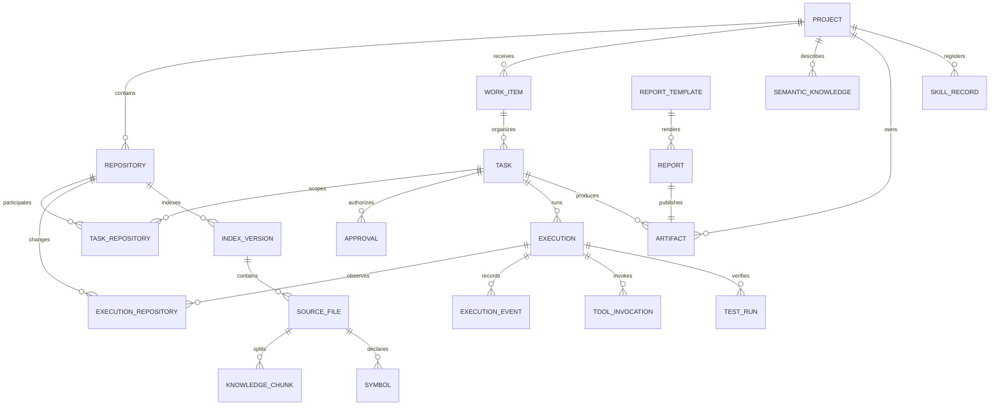

# Data Model: Q-Harness Platform MVP

**Source**: [spec.md](./spec.md)  
**Plan**: [plan.md](./plan.md)

## Conventions

- PostgreSQL is the source of truth for metadata, state and provenance; repository files remain the source of truth for code.
- Internal IDs are UUIDs. User-facing tasks additionally receive `TASK-YYYY-NNNN` from a database sequence.
- Every Project-owned row carries `project_id`; composite foreign keys prevent cross-Project relationships.
- Timestamps are UTC and immutable events use database time.
- Mutable aggregates carry `version` for optimistic concurrency.
- Paths stored in the database are canonical absolute paths for roots and normalized POSIX-style relative paths inside repositories.
- Content identity is SHA-256. A tool write must provide the hash observed by its last read.
- Extensible evidence and provider-specific metadata use bounded JSON objects, not unstructured replacement for core relational fields.
- Secrets and bearer-token values are never persisted in domain tables or events.

## Relationship Overview



## Project Boundary

### Project

| Field | Type | Rules |
|------|------|-------|
| `id` | UUID | Primary key, immutable |
| `stable_key` | text | Globally unique lowercase slug |
| `name` | text | 1–120 characters |
| `workspace_root` | text | Canonical absolute path; existing directory |
| `config_path` | text | Must resolve inside `workspace_root` |
| `status` | enum | `ACTIVE`, `UNAVAILABLE` |
| `version` | integer | Incremented on mutation |
| `created_at`, `updated_at` | timestamp | UTC |

Validation:

- `workspace_root` is resolved without following an unapproved symlink chain.
- Project discovery matches the nearest registered repository/workspace root; it never scans arbitrary parent trees.
- `UNAVAILABLE` is used when the workspace is moved or permissions are lost; no automatic deletion occurs.

### Repository

| Field | Type | Rules |
|------|------|-------|
| `id`, `project_id` | UUID | Project-scoped identity |
| `name` | text | Unique within Project |
| `role` | text | Required operator-defined role such as `api`, `web`, `mobile` |
| `declared_path` | text | Input shown to operator |
| `canonical_path` | text | Globally unique; one path belongs to one Project |
| `remote_url` | text nullable | Redacted of embedded credentials |
| `branch_name`, `head_sha` | text nullable | Current observed Git identity |
| `dirty_fingerprint` | text nullable | Hash of relevant working-tree state |
| `access_mode` | enum | `READ_ONLY`, `READ_WRITE` |
| `status` | enum | `READY`, `MISSING`, `DENIED`, `NOT_GIT` |
| `version`, timestamps` | scalar | Optimistic concurrency and audit timestamps |

Validation:

- Unique constraints: `(project_id, name)` and global `canonical_path`.
- A different checkout of the same remote is allowed because its canonical path is different.
- Every file operation re-resolves the target and proves it remains below this root; symlink escape is rejected.

## Knowledge

### IndexVersion

Represents one repository-wide index generation or a freshness boundary.

| Field | Type | Rules |
|------|------|-------|
| `id`, `project_id`, `repository_id` | UUID | Repository must belong to Project |
| `schema_version` | integer | Parser/index schema version |
| `source_fingerprint` | text | HEAD + dirty/file metadata fingerprint |
| `status` | enum | `UNINDEXED`, `INDEXING`, `FRESH`, `STALE`, `FAILED` |
| `stale_reason`, `error_code` | text nullable | Safe diagnostic, no source secrets |
| `started_at`, `indexed_at` | timestamp nullable | UTC |

Transitions:

```text
UNINDEXED -> INDEXING -> FRESH
FRESH -> STALE -> INDEXING -> FRESH
INDEXING -> FAILED
FAILED -> INDEXING
```

Only one `INDEXING` generation may exist per repository. Failed refresh keeps the prior generation queryable but explicitly stale.

### SourceFile

| Field | Type | Rules |
|------|------|-------|
| `id`, `project_id`, `repository_id`, `index_version_id` | UUID | Composite Project ownership |
| `relative_path` | text | Unique per index generation, normalized, never absolute |
| `language` | text nullable | Detected parser language |
| `content_hash` | text | SHA-256 of indexed bytes |
| `size_bytes`, `mtime_ns` | integer | Freshness inputs |
| `git_blob_sha` | text nullable | Present when Git can resolve it |
| `line_count` | integer | Non-negative |
| `parse_status` | enum | `LEXICAL_ONLY`, `PARSED`, `UNSUPPORTED`, `FAILED` |

Excluded files receive an audit count/reason but no `SourceFile` row or content.

### KnowledgeChunk

| Field | Type | Rules |
|------|------|-------|
| `id`, `project_id`, `source_file_id` | UUID | Project-scoped |
| `start_line`, `end_line` | integer | 1-based and ordered |
| `content` | text | Eligible source excerpt only |
| `search_vector` | tsvector | Derived and GIN indexed |
| `content_hash` | text | Hash of chunk content |

Search always filters `project_id` and joins provenance back to repository/file/index version.

### Symbol

| Field | Type | Rules |
|------|------|-------|
| `id`, `project_id`, `source_file_id` | UUID | Project-scoped |
| `name`, `qualified_name` | text | Required; qualified name may equal name |
| `kind` | text | Parser-normalized kind (`class`, `function`, etc.) |
| `signature` | text nullable | Source-derived only |
| `start_line`, `end_line` | integer | 1-based range |
| `parser_name`, `parser_version` | text | Provenance |

Python and TypeScript/JavaScript symbols are supported for MVP. Other text files remain lexical-only.

### SemanticKnowledge

| Field | Type | Rules |
|------|------|-------|
| `id`, `project_id`, `repository_id` | UUID | Repository is optional for Project-wide knowledge |
| `kind` | enum | `OVERVIEW`, `ARCHITECTURE`, `BUSINESS_RULE`, `ADR` |
| `title`, `content` | text | Required |
| `source_refs` | JSON array | File/symbol/commit references; required unless explicitly operator-authored |
| `confidence` | decimal nullable | 0–1 for generated summaries |
| `review_status` | enum | `GENERATED`, `VERIFIED`, `STALE` |
| `content_hash`, timestamps` | scalar | Provenance and freshness |

Generated content cannot overwrite `VERIFIED` content; it creates a candidate/new version for review.

## Work and Execution

### WorkItem

| Field | Type | Rules |
|------|------|-------|
| `id`, `project_id` | UUID | Project-scoped |
| `raw_request` | text | Redacted at trust boundary |
| `intent` | enum | `ASK`, `EXECUTE`, `REPORT`, `MANAGE_PROJECT`, `CLARIFY` |
| `type` | enum | `BUG`, `FEATURE`, `REFACTOR`, `CHORE`, `RESEARCH`, `DOCUMENT`, `OTHER` |
| `tracking_mode` | enum | `QUICK`, `TRACKED` |
| `risk` | enum | `LOW`, `MEDIUM`, `HIGH` |
| `workflow` | enum | `FAST`, `STANDARD`, `FULL_SDD`, `SPECIALIZED` |
| `documentation_mode` | enum | `AUTO`, `NONE`, `REQUIRED` |
| `report_policy` | enum | `ON_DEMAND`, `EXPLICIT_OVERRIDE` |
| `classification_confidence` | decimal | 0–1; low-confidence risky actions require confirmation |

### Task

| Field | Type | Rules |
|------|------|-------|
| `id`, `project_id`, `work_item_id` | UUID | Project-scoped |
| `display_id` | text | Unique `TASK-YYYY-NNNN` |
| `title` | text | Concise operator-visible summary |
| `status` | enum | Spec-defined task state |
| `required_gates` | JSON array | Named gates and required/optional flag |
| `blocked_reason`, `failure_code` | text nullable | Safe diagnostic |
| `version`, timestamps` | scalar | Optimistic concurrency |

Transitions:

```text
CREATED -> ANALYZING -> [WAITING_APPROVAL] -> PLANNING
PLANNING -> IMPLEMENTING -> TESTING -> REVIEWING -> COMPLETED
active state -> BLOCKED | FAILED | CANCELLED
BLOCKED -> ANALYZING | PLANNING | IMPLEMENTING | TESTING (explicit operator action)
```

`COMPLETED` is rejected unless every required gate has a passing recorded result.

### TaskRepository

Joins a task to each independently versioned repository with `repository_id`, role in task, planned scope and base branch/SHA. There is no shared branch or commit field on Task.

### Approval

| Field | Type | Rules |
|------|------|-------|
| `id`, `project_id`, `task_id` | UUID | Project-scoped |
| `status` | enum | `REQUESTED`, `APPROVED`, `REJECTED`, `EXPIRED`, `CANCELLED` |
| `scope` | JSON object | Canonical paths, tools, command patterns, network/credential grants, risk ceiling |
| `scope_hash` | text | Immutable comparison key |
| `requested_at`, `decided_at`, `expires_at` | timestamp nullable | UTC |
| `decision_note` | text nullable | Operator input |

An action is allowed only when it is contained by one active approved scope. Expansion creates a new Approval; it never mutates the old decision.

### Execution

| Field | Type | Rules |
|------|------|-------|
| `id`, `project_id`, `task_id`, `approval_id` | UUID | Project-scoped |
| `attempt` | integer | Positive, unique per task |
| `status` | enum | `QUEUED`, `CLAIMED`, `RUNNING`, `SUCCEEDED`, `FAILED`, `CANCELLED`, `INTERRUPTED` |
| `worker_id`, `heartbeat_at` | text/timestamp nullable | Used to detect interruption |
| `sandbox_image_digest` | text | Required before RUNNING |
| `correlation_id` | text | Present on every event/log |
| `started_at`, `finished_at` | timestamp nullable | UTC |
| `error_code`, `safe_error` | text nullable | Redacted |
| `usage` | JSON nullable | Actual provider measurements only |

Transitions:

```text
QUEUED -> CLAIMED -> RUNNING -> SUCCEEDED | FAILED | CANCELLED
CLAIMED | RUNNING -> INTERRUPTED
```

On startup, a stale claimed/running heartbeat produces `INTERRUPTED`, blocks the Task, and marks affected repositories stale. It never resumes or rolls back automatically.

### ExecutionRepository

Captures per-execution repository evidence: `repository_id`, branch, pre/post HEAD, pre/post dirty fingerprint, changed-file metadata and diff checksum. Raw secret-bearing diffs are not stored in events.

### ExecutionEvent

| Field | Type | Rules |
|------|------|-------|
| `id` | increasing bigint | Ordering key |
| `project_id`, `task_id`, `execution_id` | UUID | Project-scoped |
| `event_type` | enum/text | Includes required notification types |
| `occurred_at`, `correlation_id` | scalar | Immutable |
| `payload` | JSON object | Versioned schema and redacted values |

Rows are append-only for the application database role. Notifications are a filtered projection of events, not a second source of truth.

### ToolInvocation

Stores tool name/version, risk, requested and approved scope hashes, idempotency key, start/end/status, timeout, redacted arguments, safe output summary and exit metadata. Raw secrets and unrestricted command output are excluded.

### TestRun

Stores execution/repository, command identifier, suite/type, status (`PASSED`, `FAILED`, `NOT_RUN`, `TIMED_OUT`), counts, duration, log artifact reference and commit/worktree fingerprint. `NOT_RUN` cannot satisfy a required gate.

## Artifacts, Reports and Skills

### Artifact

| Field | Type | Rules |
|------|------|-------|
| `id`, `project_id`, `task_id`, `execution_id` | UUID | Task/execution optional for manually requested reports |
| `kind` | enum | `LOG`, `DIFF`, `REPORT_DOCX`, `REPORT_XLSX`, `OTHER` |
| `status` | enum | `PENDING`, `READY`, `FAILED` |
| `relative_storage_path` | text | Must remain below configured artifact root |
| `media_type`, `size_bytes`, `sha256` | scalar | Required before READY |
| `provenance` | JSON object | Source IDs/versions and generator version |
| `created_at` | timestamp | UTC |

Publication is temporary write → reopen/validate → atomic rename → READY metadata commit.

### ReportTemplate

| Field | Type | Rules |
|------|------|-------|
| `id` | UUID | Internal identity |
| `project_id` | UUID nullable | Null means platform scope |
| `template_id`, `version` | text | Unique within effective scope; semantic version |
| `contract_path`, `template_path` | text | Canonical allowed paths |
| `output_format` | enum | `DOCX`, `XLSX` for MVP |
| `contract_checksum`, `template_checksum` | text | Immutable registration identity |
| `required_permission`, `language` | text | From contract front matter |
| `status` | enum | `ACTIVE`, `INVALID`, `SUPERSEDED` |
| `validation_evidence` | JSON object | Registration/open-save-reopen checks |

Duplicate `(scope, template_id, version)` or checksum drift invalidates registration. Arbitrary unregistered templates never render.

### Report

| Field | Type | Rules |
|------|------|-------|
| `id`, `project_id`, `template_id`, `artifact_id` | UUID | Artifact becomes required at READY |
| `state` | enum | `PENDING`, `GENERATING`, `READY`, `VIEWED`, `FAILED` |
| `request_scope` | JSON object | Date/task/repository filters |
| `missing_data` | JSON array | Explicit source gaps and policy action |
| `data_provenance` | JSON array | Source IDs and versions |
| `requested_at`, `ready_at`, `viewed_at` | timestamp nullable | UTC |

Transitions:

```text
PENDING -> GENERATING -> READY -> VIEWED
PENDING | GENERATING -> FAILED
```

`VIEWED` never mutates approval state.

### SkillRecord

Stores Project/platform scope, canonical path/source URL, name/version, manifest checksum, license, permissions, referenced script/assets checksums, verification status (`DISCOVERED`, `VERIFIED`, `REJECTED`, `STALE`) and verification evidence. Registration never executes skill scripts.

### IdempotencyRecord

Stores `(project_id, operation, idempotency_key)`, request hash, response/result reference and expiry. Reusing a key with a different request hash is rejected; same hash returns the prior result.

## Cross-Entity Invariants

1. Every Project-owned reference must have the same `project_id` on both sides.
2. A canonical repository path is globally unique.
3. Search results must carry a fresh/stale status and full source provenance.
4. A write with a changed expected hash has no side effect and emits `FILE_CONFLICT`.
5. An execution cannot RUN without an approved scope and pinned sandbox image.
6. A task cannot COMPLETE with missing/failed/NOT_RUN required gates.
7. An interrupted execution cannot resume automatically; a user action creates/authorizes the next attempt.
8. An artifact/report cannot become READY before checksum, openability and contract validation pass.
9. Events are append-only; current state is an optimized projection that must agree with event transitions.
10. Usage/cost fields are null when the provider did not supply trustworthy measurements.

