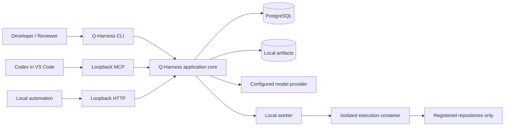
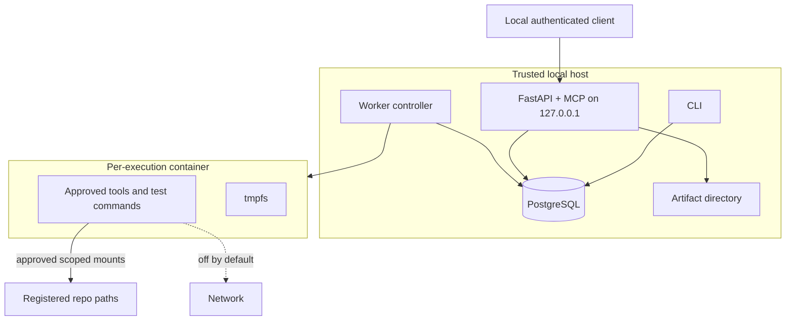
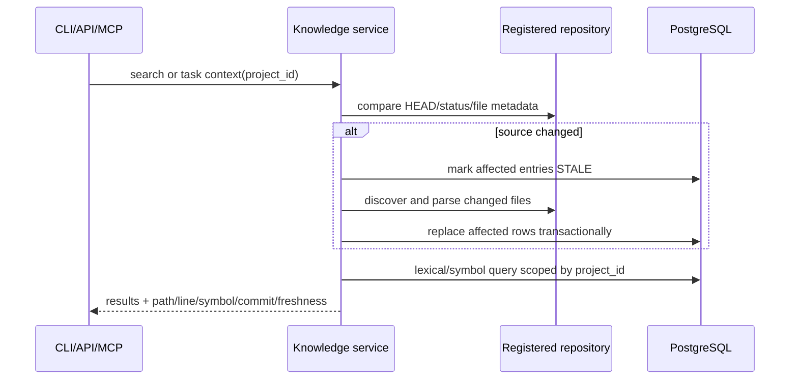
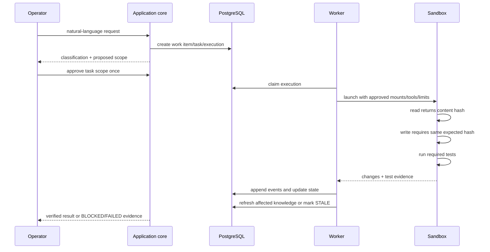

# Implementation Plan: Q-Harness Platform MVP

**Branch**: `001-q-harness-platform` | **Date**: 2026-10-24 | **Spec**: [spec.md](./spec.md)

**Input**: Feature specification from `specs/001-q-harness-platform/spec.md`

## Summary

Build Q-Harness as one Python modular monolith with four thin entrypoints: native CLI, loopback HTTP service, MCP server mounted into the same service, and a local worker that launches isolated execution containers. All entrypoints call the same application services and policy checks. PostgreSQL stores project metadata, task/execution state, immutable events and the lexical/symbol index; generated artifacts remain on the local filesystem with checksums and provenance in PostgreSQL.

The first vertical slice proves the full MVP path: register one Project with two repositories, index and search both with source references, ask read-only questions, execute one bounded Standard coding task with real tests and conflict protection, refresh knowledge, then generate validated DOCX/XLSX reports. No web UI, distributed queue, vector database, automatic checkpoint resume or multi-agent runtime is included.

## Technical Context

**Language/Version**: Python 3.12 baseline (`requires-python >=3.12`)

**Primary Dependencies**: FastAPI 0.158 line, Pydantic 2.13 line, Typer 0.26 line, SQLAlchemy 2.1 line, Alembic 1.20 line, Psycopg 3.3 line, MCP Python SDK 2.x, OpenAI Python SDK using Responses API, Tree-sitter 0.25-compatible Python/TypeScript grammars, `docxtpl` + `python-docx`, `openpyxl` + `defusedxml`; exact resolved versions locked during bootstrap

**Storage**: PostgreSQL 18 for metadata/events/search/worker queue; local filesystem for rendered artifacts; project-controlled `.qharness/project.yaml` and report contracts/templates only

**Testing**: pytest 9 line; unit, integration with real PostgreSQL, HTTP/CLI/MCP contract tests, sandbox security tests and end-to-end fixture repositories; no async test plugin unless async application code is introduced

**Target Platform**: Local-first macOS and Linux hosts with Docker available; native Windows is deferred, WSL may be evaluated after MVP

**Project Type**: Installable CLI + loopback service + MCP server + local isolated worker in one package

**Performance Goals**: 95% of project status and knowledge queries return within 3 seconds; one-file refresh completes or reports stale within 30 seconds; a new operator completes init → two repositories → first sourced result within 10 minutes

**Constraints**: Bind service/MCP to `127.0.0.1`; bearer token required; one repository path belongs to one Project; explicit Project scope on every service/MCP request; deny-by-default tools/network; one approval per bounded task scope; content-hash compare-before-write; no automatic resume, rollback, merge or overwrite after interruption/conflict

**Scale/Scope**: Acceptance environment covers 10 Projects, 20 repositories per Project and 100,000 eligible files per Project; one trusted local operator and one active Project context per client session

## Constitution Check

*GATE: Must pass before Phase 0 research. Re-checked after Phase 1 design.*

The repository constitution is still an unratified placeholder, so it defines no enforceable project gates. Planning therefore applies the active `AGENTS.md` rules and approved specification as provisional governance.

### Pre-Research Gate

| Gate | Result | Evidence |
|------|--------|----------|
| Minimum complete scope | PASS | One package, one database, one worker model; deferred features remain excluded. |
| Reuse before abstraction | PASS | Standard protocol/library adapters are used only at real boundaries; no framework fork. |
| Security boundaries | PASS | Loopback token, Project-scoped paths, container isolation and server-side authorization are mandatory. |
| Verifiable behavior | PASS | Each vertical slice maps to spec scenarios and real test evidence. |
| Data safety | PASS | Compare-before-write, no automatic rollback/merge, immutable events and reversible migrations. |
| Constitution status | PASS (provisional) | No ratified clauses exist; constitution ratification remains a governance task before implementation approval if required. |

### Post-Design Gate

PASS. Phase 1 keeps one shared application layer, does not add Redis, Elasticsearch, a vector store, web UI or LangGraph, and provides contracts and acceptance paths for every external interface. The design introduces no constitution violation.

## Project Structure

### Documentation (this feature)

```text
specs/001-q-harness-platform/
├── spec.md
├── plan.md
├── research.md
├── data-model.md
├── quickstart.md
├── contracts/
│   ├── cli.md
│   ├── mcp-tools.md
│   ├── openapi.yaml
│   ├── report-contract.md
│   └── report-contract.schema.json
└── tasks.md                    # created later by $speckit-tasks
```

### Source Code (repository root)

```text
pyproject.toml
Dockerfile.sandbox
compose.yaml                    # PostgreSQL for local development/tests
src/qharness/
├── config.py
├── domain/                     # entities, value objects, states, transition rules
├── projects/                   # Project/workspace/repository use cases
├── knowledge/                  # discovery, parsers, indexing, freshness, search
├── tasks/                      # work items, tasks, approvals, executions, events
├── runtime/                    # provider adapter, Standard workflow, tool policy
├── reports/                    # registry, data collection, renderers, validators
├── skills/                     # discovery and trust validation only
├── security/                   # path/token/secret/permission enforcement
├── infrastructure/            # PostgreSQL repositories, artifact store, Docker adapter
└── interfaces/
    ├── cli.py
    ├── http.py
    ├── mcp.py
    └── worker.py
migrations/
tests/
├── unit/
├── integration/
├── contract/
├── e2e/
├── security/
├── performance/
└── fixtures/
    ├── repositories/           # independent Python and TypeScript Git repos
    ├── reports/                # DOCX/XLSX templates and source data
    ├── scopes/                 # approved execution scopes
    └── workspaces/             # Project anchors/config fixtures
docs/
└── troubleshooting.md
```

**Structure Decision**: Use one `src/qharness` distribution and keep business rules in domain/application modules. CLI, HTTP, MCP and worker modules translate transports only. Direct module calls are preferred inside the monolith; introduce an interface only for replaceable external boundaries: model provider, sandbox runner, artifact store and language parser.

## Architecture

### System Context



### Runtime Containers and Trust Boundaries



### Component Responsibilities

| Component | Owns | Must not own |
|-----------|------|--------------|
| Interfaces | Parsing, authentication envelope, DTO mapping, presentation | Business transitions or authorization decisions |
| Project module | Project/repository identity, canonical paths, active-context resolution | Source parsing or task execution |
| Knowledge module | Discovery, exclusions, source provenance, freshness and retrieval | Semantic claims without evidence |
| Task module | Work items, task/execution states, approvals, append-only events | Direct shell/container access |
| Runtime module | Intent/workflow selection, model loop, quality gates | Bypassing policy or sandbox boundaries |
| Security module | Token, path, permission, approval and redaction decisions | Transport-specific response formatting |
| Infrastructure | PostgreSQL, filesystem and Docker adapters | Product policy |
| Report module | Contract resolution, governed collection, rendering and validation | Inventing missing data |

## Critical Flows

### Knowledge Refresh



### Standard Coding Execution



### Governed Report Generation

```mermaid
sequenceDiagram
    participant U as CLI/API/MCP
    participant R as Report service
    participant D as PostgreSQL
    participant F as Template/artifact store
    U->>R: generate(template_id, project_id)
    R->>F: verify checksum and read report.md first
    R->>D: collect allowed source data + provenance
    R->>F: render in isolated no-network process
    R->>F: reopen and validate structure/content
    alt validation passes
        R->>D: READY + checksum + provenance
    else validation fails
        R->>D: failure evidence; never READY
    end
```

## Interface and Permission Matrix

| Capability | CLI | HTTP | MCP | Approval/Policy |
|------------|-----|------|-----|-----------------|
| Project list/status | Yes | Yes | `project_get` | Local token for service/MCP; Project scope required |
| Knowledge search | Yes | Yes | `knowledge_search` | Read-only; freshness check required |
| `/ask` | Yes | Yes | Deferred as a model-facing MCP tool | Read-only tool registry, no side effects |
| Task status/events | Yes | Yes | `task_get` | Project scope required |
| Notification events | Yes | Yes | Via `task_get` for one task | Read-only event projection; no background push |
| Coding execution | Yes | Yes | Deferred | One approved task scope; re-approve escalation |
| Report list | Yes | Yes | `report_list` | Read-only |
| Report generation | Yes | Yes | `report_generate` | Explicit request, allowed data sources and artifact directory only |
| Template/skill registration | Yes | Deferred | No | Local operator; checksum, license and trust validation |

Server-side authorization is authoritative. Codex tool enablement and client approval settings are defense-in-depth only.

## Data and Transaction Boundaries

- One application-service command uses one synchronous database transaction.
- State transitions append an event and update the current aggregate version atomically.
- A single local worker claims queued executions with row locking; Redis/Celery is not introduced.
- Index refresh replaces rows for each changed file in one transaction after verifying the source hash still matches.
- Tool writes require the hash returned by the last read; mismatch produces `FILE_CONFLICT`, leaves source untouched and blocks the task.
- Artifact publication uses write-to-temporary, validate, atomic rename, then metadata commit. Failed artifacts never become READY.
- Reversible Alembic migrations are mandatory; destructive migrations require a separate approved migration plan.
- Local backup/restore documentation covers PostgreSQL plus the artifact directory; scheduled backup automation is deferred, but one restore drill is required before MVP acceptance.

## Testing Strategy

| Layer | Scope |
|-------|-------|
| Unit | State transitions, path canonicalization, exclusions, permission decisions, report contract parsing, redaction and hash conflict checks |
| Integration | PostgreSQL repositories/migrations/search, real Git fixtures, Tree-sitter parsers, artifact render/reopen, interruption recovery |
| Contract | CLI exit/output, OpenAPI examples/errors, MCP tool schemas/results, report front matter/schema |
| Sandbox security | Mount escape, symlink escape, network denied, resource/time limits, missing approval and missing token |
| End-to-end | Two independent repos, incremental refresh, bounded coding task with real tests, Codex MCP read flow, DOCX/XLSX report generation |
| Performance | 100,000-file synthetic fixture, p95 query target and one-file refresh target |

Quality gates for code changes are formatter/lint, type checking, unit tests, affected integration/contract tests, security tests where boundaries change, and acceptance checks. A required gate that is failed or not run prevents `COMPLETED`.

## Delivery Slices

1. **Foundation and Project boundary**: package, configuration, migrations, Project/repository registration, canonical-path isolation and CLI status.
2. **Knowledge vertical slice**: discovery/exclusions, Python and TypeScript symbols, PostgreSQL lexical search, provenance and freshness refresh.
3. **Read-only interfaces**: loopback service/token, CLI ask, MCP project/search/task/report-list contracts.
4. **Standard execution**: tasks/events/approvals, PostgreSQL worker claim, Docker sandbox, compare-before-write and real tests.
5. **Reports and audit**: report registry, weekly DOCX, test-results XLSX, validation, artifacts and notifications.
6. **Acceptance hardening**: interruption recovery, multi-repository e2e, isolation/security/load tests and clean-machine quickstart.

Each slice must be demonstrable and tested before the next slice expands the surface.

## Complexity Tracking

No constitution violations require justification. The four entrypoints share one package and application layer; they are required product interfaces, not separate services.

