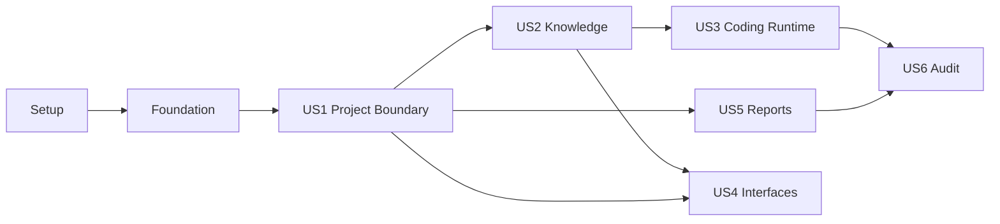

---

description: "Dependency-ordered implementation tasks for Q-Harness Platform MVP"
---

# Tasks: Q-Harness Platform MVP

**Input**: Design documents from `specs/001-q-harness-platform/`

**Prerequisites**: `plan.md`, `spec.md`, `research.md`, `data-model.md`, `contracts/`, `quickstart.md`

**Tests**: Required. Each user-story phase starts with tests that must fail for the intended reason before implementation begins.

**Organization**: Tasks are grouped by user story so each story can be implemented and validated as an independent increment.

## Format: `[ID] [P?] [Story] Description`

- **[P]**: Can run in parallel because it changes different files and has no dependency on another incomplete task in the same batch.
- **[Story]**: Maps the task to a user story from `spec.md`.
- Every task names the exact file or directory it changes.

## Phase 1: Setup (Shared Infrastructure)

**Purpose**: Bootstrap one installable Python package and reproducible local development environment without creating speculative modules.

- [X] T001 Create the Python 3.12 PEP 621 package, runtime/dev dependency groups, exact lock/constraints workflow and `qh` console entry point in `pyproject.toml` and `src/qharness/__init__.py`
- [X] T002 [P] Add the PostgreSQL 18 local/test service with health check and persistent development volume in `compose.yaml`
- [X] T003 [P] Add the digest-pinnable non-root sandbox image with only Git, ripgrep, Python and Node test tooling in `Dockerfile.sandbox`
- [X] T004 [P] Define non-secret local settings and generated-state exclusions in `.env.example` and `.gitignore`
- [X] T005 Configure pytest, Ruff and mypy gates plus shared test markers in `pyproject.toml` and `tests/conftest.py`
- [X] T006 [P] Build deterministic independent Git repository/workspace fixtures in `tests/fixtures/build.py` and `tests/fixtures/README.md`

**Checkpoint**: Package installation, PostgreSQL startup and empty pytest collection succeed on Python 3.12.

---

## Phase 2: Foundational (Blocking Prerequisites)

**Purpose**: Shared configuration, persistence, errors and safety primitives required by every user story.

**Critical**: No user-story implementation begins until this phase passes.

- [X] T007 [P] Write failing settings, loopback-bind and secret-redaction tests in `tests/unit/test_config.py` and `tests/unit/test_redaction.py`
- [X] T008 [P] Write failing database transaction, migration round-trip and idempotency tests in `tests/integration/test_database_bootstrap.py` and `tests/integration/test_idempotency.py`
- [X] T009 Implement validated environment settings, required model/token handling and loopback-only service configuration in `src/qharness/config.py`
- [X] T010 Implement synchronous SQLAlchemy engine/session lifecycle and transaction helper in `src/qharness/infrastructure/database.py`
- [X] T011 Initialize reversible Alembic migration infrastructure and schema-version checks in `alembic.ini`, `migrations/env.py` and `migrations/script.py.mako`
- [X] T012 [P] Implement UUID/display-ID value objects, shared enums, transition helpers and stable error codes in `src/qharness/domain/types.py`, `src/qharness/domain/states.py` and `src/qharness/domain/errors.py`
- [X] T013 [P] Implement structured correlation logging and recursive secret redaction in `src/qharness/infrastructure/logging.py` and `src/qharness/security/redaction.py`
- [X] T014 Implement transactional idempotency records and same-key/different-request rejection in `src/qharness/infrastructure/idempotency.py`

**Checkpoint**: Configuration refuses unsafe startup, migrations upgrade/downgrade cleanly, and redacted errors preserve a correlation ID.

---

## Phase 3: User Story 1 — Create an Isolated Multi-Repository Project (Priority: P1) 🎯 First MVP Increment

**Goal**: Register multiple Projects and independent repositories while enforcing canonical-path ownership and Project isolation.

**Independent Test**: Create Project A with two repositories and Project B with one repository, resolve the active Project from each working directory, then prove duplicate paths, traversal, symlink escape and cross-Project access are rejected.

### Tests for User Story 1

> Write and run T015–T018 first; confirm they fail because the Project boundary is not implemented.

- [X] T015 [P] [US1] Write unit tests for canonical paths, nearest-root discovery and unavailable workspace states in `tests/unit/test_project_paths.py`
- [X] T016 [P] [US1] Write PostgreSQL integration tests for Project/Repository uniqueness, composite Project ownership and optimistic versions in `tests/integration/test_projects.py`
- [X] T017 [P] [US1] Write CLI contract tests for `qh init` and `qh project add|list|use|status` JSON/human outputs and exit codes in `tests/contract/test_cli_projects.py`
- [X] T018 [P] [US1] Write path traversal, symlink escape, duplicate canonical path and cross-Project denial tests in `tests/security/test_project_isolation.py`

### Implementation for User Story 1

- [X] T019 [P] [US1] Implement Project and Repository persistence/domain models with composite ownership constraints in `src/qharness/projects/models.py`
- [X] T020 [US1] Create reversible Project/Repository tables, indexes and uniqueness constraints in `migrations/versions/0001_projects.py`
- [X] T021 [P] [US1] Implement canonical-root containment and per-operation symlink revalidation in `src/qharness/security/paths.py`
- [X] T022 [P] [US1] Implement read-only Git branch, HEAD, remote and dirty-fingerprint inspection in `src/qharness/projects/git.py`
- [X] T023 [US1] Implement Project creation, repository registration, working-directory discovery and `.qharness/project.yaml` handling in `src/qharness/projects/service.py` and `src/qharness/projects/config.py`
- [X] T024 [US1] Implement `qh init` and `qh project add|list|use|status` with stable envelopes/exit codes in `src/qharness/interfaces/cli.py`
- [X] T025 [US1] Prove the complete two-Project/three-repository journey with real Git fixtures in `tests/e2e/test_project_workspace.py`

**Checkpoint**: US1 passes independently with no knowledge index, model provider or execution runtime installed.

---

## Phase 4: User Story 2 — Build and Refresh Trusted Project Knowledge (Priority: P1)

**Goal**: Index registered repositories, search text/symbols with provenance, and expose stale/incremental refresh behavior without leaking excluded data.

**Independent Test**: Index Python and TypeScript repositories, search by text and symbol through the CLI, modify one file externally, refresh only that file and prove Project B and excluded secrets never appear.

### Tests for User Story 2

> Write and run T026–T029 first; confirm failures cover discovery, parser, persistence and isolation behavior.

- [X] T026 [P] [US2] Write file-discovery, denylist, binary/size/encoding and Git-ignore tests in `tests/unit/test_knowledge_discovery.py`
- [X] T027 [P] [US2] Write parser contract tests for Python, TypeScript/JavaScript and lexical-only fallback fixtures in `tests/contract/test_language_parsers.py`
- [X] T028 [P] [US2] Write PostgreSQL full/incremental indexing, GIN search, provenance and stale-failure tests in `tests/integration/test_knowledge_index.py`
- [X] T029 [P] [US2] Write cross-Project search and secret/build-output exclusion tests in `tests/security/test_knowledge_isolation.py`

### Implementation for User Story 2

- [X] T030 [P] [US2] Implement IndexVersion, SourceFile, KnowledgeChunk, Symbol and SemanticKnowledge models in `src/qharness/knowledge/models.py`
- [X] T031 [US2] Create reversible knowledge tables, Project-scoped foreign keys and GIN indexes in `migrations/versions/0002_knowledge.py`
- [X] T032 [P] [US2] Implement ripgrep-backed discovery with the explicit Q-Harness denylist and no symlink following in `src/qharness/knowledge/discovery.py`
- [X] T033 [P] [US2] Implement version-locked Tree-sitter Python/TypeScript symbol extractors and lexical fallback in `src/qharness/knowledge/parsers.py`
- [X] T034 [US2] Implement bounded line chunking and per-file transactional row replacement with source-hash recheck in `src/qharness/knowledge/indexer.py`
- [X] T035 [US2] Implement Project-scoped ranked lexical/symbol retrieval and complete provenance mapping in `src/qharness/knowledge/search.py`
- [X] T036 [US2] Implement Git/file fingerprint freshness checks, incremental refresh and actionable stale results in `src/qharness/knowledge/freshness.py`
- [X] T037 [US2] Implement `qh project index|refresh` and `qh knowledge search` commands in `src/qharness/interfaces/cli.py`
- [X] T038 [US2] Prove sourced search, one-file refresh and cross-Project isolation end to end in `tests/e2e/test_knowledge_workflow.py`

**Checkpoint**: US2 returns fresh path/line/symbol/commit references independently of `/ask` or coding execution.

---

## Phase 5: User Story 3 — Execute a Verifiable Coding Task (Priority: P1)

**Goal**: Classify a natural-language request, approve one bounded scope, execute changes in an isolated worker, run real tests and prevent unsafe completion/conflicting writes.

**Independent Test**: Run one task across the API and web fixture repositories, approve once, verify both repository tests, then separately prove scope escalation, file conflict, test failure and worker interruption block completion.

### Tests for User Story 3

> Write and run T039–T044 first; implementation starts only after failures demonstrate missing runtime behavior.

- [X] T039 [P] [US3] Write task/work-item state, intent classification and adaptive-document-policy tests in `tests/unit/test_task_states.py` and `tests/unit/test_classifier.py`
- [X] T040 [P] [US3] Write approval containment, scope escalation, content-hash compare-before-write and execution idempotency tests in `tests/unit/test_execution_policy.py`
- [X] T041 [P] [US3] Write PostgreSQL task/event/test-run persistence and `SKIP LOCKED` worker-claim tests in `tests/integration/test_execution_store.py`
- [X] T042 [P] [US3] Write sandbox tests for mounts, non-root user, dropped capabilities, read-only root, no network and resource/time limits in `tests/security/test_sandbox.py`
- [X] T043 [P] [US3] Write external-file-conflict and stale-heartbeat interruption recovery tests in `tests/integration/test_file_conflict.py` and `tests/integration/test_interrupted_execution.py`
- [X] T044 [P] [US3] Write the two-repository success/test-fail/NOT_RUN acceptance flow in `tests/e2e/test_standard_coding_task.py`

### Implementation for User Story 3

- [X] T045 [P] [US3] Implement WorkItem, Task, TaskRepository, Approval, Execution, ExecutionRepository, ExecutionEvent, ToolInvocation and TestRun models in `src/qharness/tasks/models.py`
- [X] T046 [US3] Create reversible task/execution/event/test/idempotency schema and user-facing task sequence in `migrations/versions/0003_tasks.py`
- [X] T047 [P] [US3] Implement deterministic intent/risk/workflow/document classification with low-confidence confirmation in `src/qharness/runtime/classifier.py`
- [X] T048 [P] [US3] Implement the `ModelProvider` protocol and configurable OpenAI Responses adapter without a hardcoded model in `src/qharness/runtime/providers.py`
- [X] T049 [US3] Implement immutable one-scope approval decisions and escalation checks in `src/qharness/tasks/approvals.py` and `src/qharness/security/policy.py`
- [X] T050 [US3] Implement schema-validated file/read/write/search/command/test tools with redaction, timeouts and expected hashes in `src/qharness/runtime/tools.py`
- [X] T051 [P] [US3] Implement the Docker runner with pinned image, scoped mounts, disabled network and resource constraints in `src/qharness/infrastructure/sandbox.py`
- [X] T052 [US3] Implement PostgreSQL execution claiming, heartbeat, cancellation and container cleanup in `src/qharness/interfaces/worker.py`
- [X] T053 [US3] Implement the Standard workflow, bounded retry, quality gates, immutable events and post-execution knowledge refresh/stale marking in `src/qharness/runtime/standard.py` and `src/qharness/tasks/service.py`
- [X] T054 [US3] Implement `qh run` and `qh task list|status|approve|execute|continue|cancel` in `src/qharness/interfaces/cli.py`

**Checkpoint**: US3 completes only with real passing gates and remains BLOCKED/FAILED with inspectable evidence otherwise.

---

## Phase 6: User Story 4 — Ask Safely from Supported Interfaces (Priority: P2)

**Goal**: Provide consistent read-only answers and status through CLI, HTTP and Codex MCP with loopback token authentication and Project-scoped authorization.

**Independent Test**: Ask the same question through all three interfaces, compare citations, attempt write-tool injection, omit/alter the token and request another Project; every unsafe request must fail before data access.

### Tests for User Story 4

> Write and run T055–T058 first; keep report-list fixtures read-only so US4 does not depend on report rendering.

- [X] T055 [P] [US4] Write missing/invalid token, non-loopback bind, Origin/host and Project-scope security tests in `tests/security/test_local_service_auth.py`
- [X] T056 [P] [US4] Write concise `/ask` citation and write-tool denial tests in `tests/integration/test_read_only_ask.py`
- [X] T057 [P] [US4] Write OpenAPI contract tests for health, Project, knowledge, task, action and notification operations in `tests/contract/test_openapi.py`
- [X] T058 [P] [US4] Write MCP schema, structured result/error, Project isolation and CLI/HTTP parity tests in `tests/contract/test_mcp_tools.py`

### Implementation for User Story 4

- [X] T059 [P] [US4] Implement the minimal read-only ReportTemplate catalog model and seedable migration for `qh_report_list` in `src/qharness/reports/models.py` and `migrations/versions/0004_report_catalog.py`
- [X] T060 [P] [US4] Implement bearer-token, loopback, host/Origin and explicit Project-scope enforcement in `src/qharness/security/auth.py`
- [X] T061 [US4] Implement authenticated health, Project, knowledge, task/action and notification HTTP operations matching `contracts/openapi.yaml` in `src/qharness/interfaces/http.py`
- [X] T062 [P] [US4] Implement read-only ask orchestration, bounded retrieval context and Caveman-only answer formatting in `src/qharness/runtime/ask.py`
- [X] T063 [US4] Implement `qh ask` and `qh serve` commands with the shared application services in `src/qharness/interfaces/cli.py`
- [X] T064 [US4] Implement `qh_project_get`, `qh_knowledge_search`, `qh_task_get` and `qh_report_list` with structured MCP output in `src/qharness/interfaces/mcp.py`
- [X] T065 [US4] Mount MCP Streamable HTTP into the loopback FastAPI lifespan without duplicating business logic in `src/qharness/interfaces/http.py`
- [X] T066 [US4] Document token-by-environment Codex configuration and prove CLI/HTTP/MCP parity end to end in `docs/codex-mcp.md` and `tests/e2e/test_supported_interfaces.py`

**Checkpoint**: US4 is usable with seeded task/report metadata and no coding/report-generation MCP side effects.

---

## Phase 7: User Story 5 — Generate a Report from a Governed Template (Priority: P2)

**Goal**: Register trusted versioned report templates and generate validated DOCX/XLSX artifacts from authorized source data without inventing missing values.

**Independent Test**: Register one weekly DOCX and one test-results XLSX template, generate both from full and missing-data fixtures, reopen outputs and prove invalid contracts/templates never reach READY.

### Tests for User Story 5

> Write and run T067–T071 first; include negative cases for checksum drift, unresolved variables, unsupported workbook features and missing data.

- [X] T067 [P] [US5] Write report front-matter schema, precedence and missing-data-policy unit tests in `tests/unit/test_report_contract.py`
- [X] T068 [P] [US5] Write template path/checksum/version/license/trust registration tests in `tests/integration/test_report_registry.py`
- [X] T069 [P] [US5] Write sandboxed DOCX render, reopen, required-section and unresolved-placeholder tests in `tests/integration/test_docx_reports.py`
- [X] T070 [P] [US5] Write XLSX sheet/range/style/formula-string and independent-total validation tests in `tests/integration/test_xlsx_reports.py`
- [X] T071 [P] [US5] Write CLI, HTTP and MCP report-list/generate/status contract tests in `tests/contract/test_report_interfaces.py`

### Implementation for User Story 5

- [X] T072 [P] [US5] Extend report models with Artifact, Report and full ReportTemplate state/provenance fields in `src/qharness/reports/models.py`
- [X] T073 [US5] Create reversible artifact/report/template constraints and state indexes in `migrations/versions/0005_reports.py`
- [X] T074 [US5] Implement `report.md` YAML/front-matter validation, checksum-pinned registration and compatibility preflight in `src/qharness/reports/registry.py`
- [X] T075 [P] [US5] Implement authorized Project/task/execution/test data collection and explicit provenance/missing-data records in `src/qharness/reports/collector.py`
- [X] T076 [P] [US5] Implement temporary-write, checksum, path containment and atomic artifact publication in `src/qharness/infrastructure/artifacts.py`
- [X] T077 [P] [US5] Implement strict sandboxed `docxtpl` rendering and `python-docx` structural validation in `src/qharness/reports/docx.py`
- [X] T078 [P] [US5] Implement `openpyxl`/`defusedxml` population, reopen and formula/total validation in `src/qharness/reports/xlsx.py`
- [X] T079 [P] [US5] Create governed weekly-progress and test-results contracts plus deterministic template-build fixtures in `src/qharness/reports/templates/` and `tests/fixtures/reports/build_templates.py`
- [X] T080 [US5] Implement report generation state transitions, idempotency, validation evidence and REPORT_READY emission in `src/qharness/reports/service.py`
- [X] T081 [US5] Implement `qh report`/template commands, HTTP report operations and `qh_report_generate` MCP tool in `src/qharness/interfaces/cli.py`, `src/qharness/interfaces/http.py` and `src/qharness/interfaces/mcp.py`
- [X] T082 [US5] Prove valid DOCX/XLSX generation, missing-data policies and invalid-template rejection end to end in `tests/e2e/test_report_generation.py`

**Checkpoint**: US5 publishes only reopenable validated artifacts with exact template version/checksum and source provenance.

---

## Phase 8: User Story 6 — Inspect Auditable Progress (Priority: P3)

**Goal**: Expose an immutable, redacted timeline of task/execution/approval/test/artifact activity and recover interrupted executions without false completion.

**Independent Test**: Produce successful, failed-test, cancelled and interrupted executions, then verify the timeline and notification projection show correct states/evidence while invalid transitions and event mutation are rejected.

### Tests for User Story 6

> Write and run T083–T086 first; use real PostgreSQL constraints for immutability and recovery.

- [X] T083 [P] [US6] Write event append-only, transition rejection, payload version and secret-redaction tests in `tests/unit/test_audit_events.py`
- [X] T084 [P] [US6] Write timeline ordering, per-repository evidence, test/artifact linkage and notification projection tests in `tests/integration/test_audit_timeline.py`
- [X] T085 [P] [US6] Write startup reconciliation tests for stale heartbeats, INTERRUPTED outcome, BLOCKED task and stale knowledge in `tests/integration/test_interrupted_execution.py`
- [X] T086 [P] [US6] Write CLI/API status and `qh notification list` contract tests in `tests/contract/test_audit_interfaces.py`

### Implementation for User Story 6

- [X] T087 [P] [US6] Implement Project-scoped audit timeline and redacted evidence projections in `src/qharness/tasks/audit.py`
- [X] T088 [P] [US6] Implement startup stale-heartbeat reconciliation with no automatic resume/rollback in `src/qharness/tasks/recovery.py`
- [X] T089 [US6] Implement rich task status and notification queries in `src/qharness/interfaces/cli.py` and `src/qharness/interfaces/http.py`
- [X] T090 [US6] Prove success, failed-test, cancellation and interruption timelines end to end in `tests/e2e/test_audit_and_recovery.py`

**Checkpoint**: US6 reconstructs why every execution completed, failed, blocked, cancelled or was interrupted without revealing secrets.

---

## Phase 9: Polish & Cross-Cutting Acceptance

**Purpose**: Complete requirements not owned by one story and prove the whole MVP against security, scale, licensing and documentation gates.

- [X] T091 [P] Write skill provenance, license, checksum, permission and no-script-execution tests in `tests/security/test_skill_registry.py`
- [X] T092 Implement read-only skill discovery/verification, SkillRecord persistence and `qh skill list|verify` in `src/qharness/skills/registry.py`, `migrations/versions/0006_skills.py` and `src/qharness/interfaces/cli.py`
- [X] T093 [P] Build the 10-Project/20-repository/100,000-file generator and p95 search/refresh acceptance benchmark in `tests/performance/test_acceptance_scale.py`
- [X] T094 [P] Record dependency versions, parser grammar licenses, Psycopg/docxtpl obligations and release decisions in `docs/dependency-review.md`
- [X] T095 [P] Implement and test local PostgreSQL+artifact backup/restore drill documentation in `scripts/backup-local.sh`, `scripts/restore-local.sh`, `tests/integration/test_backup_restore.py` and `docs/backup-restore.md`
- [X] T096 [P] Write installation, local operation, command reference and troubleshooting material aligned to the contracts in `README.md` and `docs/troubleshooting.md`
- [X] T097 Run the cross-story token/path/symlink/network/credential/redaction regression suite and close findings in `tests/security/test_cross_cutting_security.py`
- [X] T098 Run format, lint, type, unit, integration, contract, e2e, security and performance gates and record actual outcomes in `docs/verification.md`
- [ ] T099 Execute the clean-environment `quickstart.md` walkthrough on macOS and Linux acceptance hosts and update only inaccurate steps in `specs/001-q-harness-platform/quickstart.md`

  Partial evidence: macOS fresh-virtualenv smoke passed; native Linux walkthrough is NOT_RUN. See `docs/verification.md` for host coverage and remaining acceptance gates.

**Final Checkpoint**: All required gates pass; any NOT_RUN/failed gate keeps the feature unverified and not complete.

---

## Dependencies & Execution Order

### Phase Dependencies

- **Phase 1 Setup**: starts immediately.
- **Phase 2 Foundation**: depends on Phase 1 and blocks every user story.
- **US1**: depends on Foundation.
- **US2**: depends on US1 because only registered repositories may be indexed.
- **US3**: depends on US1 + US2 for Project scope, task context and post-change refresh.
- **US4**: depends on US1 + US2; task/report reads can use seeded fixtures while US3/US5 are incomplete.
- **US5**: depends on US1 + Foundation and may run in parallel with US2–US4 after its report catalog prerequisite is coordinated with T059.
- **US6**: depends on US3 + US5 because it audits execution and report events.
- **Polish**: depends on all desired stories; T091/T094/T096 may start earlier once Foundation paths stabilize.

### User Story Dependency Graph



### Within Each Story

1. Write the story tests and confirm they fail for the intended missing behavior.
2. Add models/migrations before services that persist them.
3. Add domain/application behavior before transport adapters.
4. Run the story's unit/integration/contract/security tests.
5. Run its independent end-to-end test and stop at the checkpoint.

## Parallel Opportunities

### User Story 1

```text
Parallel test batch: T015, T016, T017, T018
Parallel implementation batch after contracts settle: T019, T021, T022
```

### User Story 2

```text
Parallel test batch: T026, T027, T028, T029
Parallel implementation batch: T030, T032, T033
```

### User Story 3

```text
Parallel test batch: T039, T040, T041, T042, T043, T044
Parallel adapter batch after task contracts settle: T047, T048, T051
```

### User Story 4

```text
Parallel test batch: T055, T056, T057, T058
Parallel implementation batch: T059, T060, T062
```

### User Story 5

```text
Parallel test batch: T067, T068, T069, T070, T071
Parallel renderer/data batch after report schema settles: T075, T076, T077, T078, T079
```

### User Story 6

```text
Parallel test batch: T083, T084, T085, T086
Parallel implementation batch: T087, T088
```

## Implementation Strategy

### First MVP Increment: US1

1. Complete Setup and Foundation.
2. Complete US1 tests and implementation.
3. Stop and validate multi-Project/multi-repository isolation independently.
4. Demo Project creation and safe context switching before adding indexing/runtime complexity.

US1 is the first demonstrable increment, not the complete Q-Harness product MVP. The product MVP requires US1–US6 plus the final acceptance phase.

### Incremental Delivery

1. **US1** establishes the trusted Project boundary.
2. **US2** adds useful sourced knowledge without any write-capable agent.
3. **US3** adds bounded coding execution and real quality gates.
4. **US4** exposes safe parity across CLI/HTTP/MCP.
5. **US5** adds governed report generation.
6. **US6** closes audit and interruption recovery.
7. Polish proves scale, security, licensing, backup and clean-machine usability.

### Parallel Team Strategy

After Foundation and US1:

- Track A: US2, then US3.
- Track B: US5.
- Track C: US4 after US2 contracts stabilize.
- US6 starts after US3 and US5 event producers are complete.

Coordinate T059 with T072–T074 so the report catalog model/migration is extended rather than duplicated.

## Notes

- `[P]` means the listed files do not overlap with incomplete tasks in the stated batch.
- Story labels provide traceability to `spec.md` user stories.
- Do not add Phase 2/3 features such as vector search, LangGraph, Redis/Celery, web UI, remote OAuth or distributed workers.
- Do not mark a task complete unless its specified tests ran and passed; record unavailable gates as NOT_RUN.
- Preserve user changes and stop on dirty-worktree conflicts; never auto-merge, overwrite or rollback.

